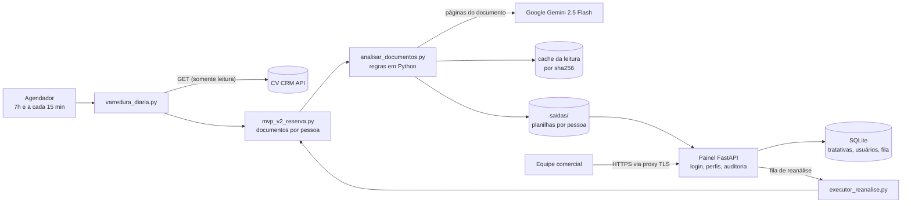

# Secretaria de Vendas — conferência automática de documentação com IA

Sistema que confere, todos os dias e sem intervenção, a documentação das reservas de imóveis no
**CV CRM** antes da validação do contrato. Ele baixa os documentos de cada comprador, usa **IA
(Google Gemini)** para ler CNH, RG, comprovantes e certidões, confronta a leitura com o cadastro do
CRM usando regras escritas em Python e publica as pendências num **painel web (FastAPI)** com login,
perfis de acesso e registro de tratativas.

Desenvolvido para a área comercial da **VIC Engenharia** (incorporadora). Esta é uma cópia pública
e higienizada do código (ver [Sobre a confidencialidade](#sobre-a-confidencialidade)).

---

## O problema

Antes de o contrato de uma venda ser validado, alguém precisa conferir, reserva por reserva, se os
documentos anexados no CRM estão completos, válidos e coerentes com o cadastro: o nome e o CPF do
documento batem com o do cliente? A identificação está vencida? O comprovante de endereço é recente?
A renda cadastrada confere com a Tela de Avaliação de Risco? Cada modalidade de venda (financiamento,
venda direta, loteamento) exige uma lista diferente, e cada pessoa da operação (titular, 2º proponente,
avalista) tem os seus documentos. Feito à mão, isso é lento, repetitivo e sujeito a erro, e o problema
costuma ser descoberto tarde, quando a venda já chegou à mesa de quem valida.

## A solução

- Uma **varredura diária** lista as reservas nas etapas do funil comercial, confirma a situação de
  cada uma e baixa os documentos por pessoa.
- A **IA só lê**: extrai nome, CPF, datas, endereço e renda de cada documento. **Quem decide são
  regras determinísticas em Python**, cada uma com a fonte registrada (cartilha da área de contratos,
  gestão comercial ou medição).
- O resultado vira uma planilha por pessoa e aparece no **painel**, onde a equipe marca cada apontamento
  como corrigido ou ignorado (com motivo). Apontamentos ignorados alimentam uma fila de revisão de regras.
- O sistema **só lê o CRM**. Quem corrige qualquer coisa é sempre uma pessoa.

## Principais funcionalidades

- **Varredura diária** (7h) com trava entre processos, repescagem de falhas e uma rodada bem-sucedida por dia.
- **Funil atualizado a cada 15 min** (só a listagem, sem IA) e botão **"Analisar/Reanalisar agora"**
  no painel, atendido por um executor residente através de uma fila.
- **Leitura de documentos com IA** (até 5 páginas por documento, 5 chamadas em paralelo, timeout de 120 s).
- **Regras de negócio em Python**: documentos exigidos por modalidade, validade de identificação e de
  comprovante de endereço, certidão de estado civil, renda por proponente, venda para pessoa jurídica,
  arquivo repetido em campos diferentes (por hash), entre outras.
- **Painel web** com lista de reservas, detalhe por pessoa, tratativas, revisão de regras, exportação
  para Excel, gestão de usuários e tela de consumo/custo da IA.
- **Auditoria**: quem criou ou alterou usuários e tratativas, e quando.

## Arquitetura



A varredura e o painel são processos independentes que só se encontram no disco: o painel **não chama
o CRM nem a IA** e não guarda nenhum segredo deles. Na implantação real, só o site foi para um servidor
da rede interna; a varredura e o executor rodam num PC de operação, que envia planilhas e documentos ao
servidor pelo próprio site (HTTPS, chave do executor, manifesto com sha256, envio retomável).

## Stack

| Camada | Tecnologia |
| --- | --- |
| Linguagem | Python 3.14 |
| Web | FastAPI, Uvicorn, Jinja2 (templates server-side; JavaScript mínimo, sem inline) |
| Banco | SQLite (`sqlite3` da biblioteca padrão) |
| IA | Google Gemini 2.5 Flash via `google-genai` |
| Documentos | PyMuPDF (PDF → imagem), openpyxl (planilhas), RapidFuzz (comparação de nomes) |
| Integração | API REST do CV CRM via `requests` |
| Infra | Windows (Agendador de Tarefas, serviço via NSSM), proxy TLS com Caddy ou IIS |
| Testes | `unittest` da biblioteca padrão, com rede e IA simuladas |

## Decisões técnicas

- **A IA lê, o Python decide.** A leitura da IA não é determinística: o mesmo arquivo pode ser lido de
  forma diferente em rodadas diferentes. Por isso toda regra que pode travar uma venda está em Python,
  e o prompt só reforça. Regra nova vale para a base inteira na próxima execução, sem nova leitura.
- **Somente leitura no CRM.** O fluxo automático só faz GET. Sugestões de correção saem numa aba da
  planilha para uma pessoa decidir; uma automação que corrige cadastro sozinha criaria um problema de
  confiança maior do que o que resolve.
- **Divergência × aviso.** Divergência é o que trava a venda pela regra; aviso é informação para quem
  confere (leitura duvidosa, documento não exigido). Documento não exigido pela modalidade é analisado,
  mas nunca gera divergência: julgar tudo o que está anexado fazia quase toda venda ter apontamento.
- **Disjuntor da IA com falha fechada.** Falha de sistema (sem saldo, limite de gasto, 429, rede,
  resposta inválida) nunca vira apontamento sobre a venda: o documento fica "aguardando leitura" e é
  relido na rodada seguinte. Sem saldo ou limite atingido, um disjuntor persistido em disco bloqueia
  novas chamadas em todos os processos até um comando explícito de liberação. Estado ilegível
  **bloqueia** (não libera), e um disjuntor que não pôde ser gravado bloqueia em memória.
- **Controle de custo da IA.** Cache da leitura por **sha256 do conteúdo** (mesmo arquivo nunca é
  relido, mesmo renomeado ou baixado de novo), gravação atômica e só de leituras válidas e completas.
  Cada chamada registra os tokens de entrada, saída e raciocínio (sem nenhum dado pessoal); uma tela só
  para admin mostra custo estimado em US$/R$, custo médio por documento e por reserva e a projeção do mês.
- **Segurança do painel.** Senhas em PBKDF2-SHA256 (390 mil iterações), sessão em cookie HttpOnly/
  SameSite com só o hash do token no banco, CSRF em todo POST, bloqueio após 5 falhas de login por
  usuário ou por IP, CSP sem script inline, `nosniff`, `X-Frame-Options`, `no-store`, CPF/CNPJ
  mascarados em toda tela, download de documento por link opaco, perfis `admin`/`gerente`/`registro`,
  troca de senha obrigatória após senha provisória e trilha de auditoria de usuários. No servidor, o
  painel escuta só em loopback atrás de um proxy TLS, confia em `X-Forwarded-For` apenas do proxy
  configurado e recusa configurações que permitiriam contorná-lo.
- **Minimização de dados.** A listagem local do CRM guarda só número, situação e modalidade da reserva;
  a exportação usada para revisar regras troca nome, endereço e CPF por marcadores.
- **Concorrência entre processos.** Uma única trava em disco é compartilhada por varredura, funil e
  executor, com dono verificado por PID e expiração quando o dono não pode ser provado vivo.
- **Operação.** Backup diário do SQLite pela API de backup com `PRAGMA integrity_check`, retenção de
  14 dias e alerta no painel; serviço do Windows com conta virtual própria (nunca LocalSystem).

## Testes

Suíte com **339 testes** (`unittest`) em `painel/tests/`, totalmente offline: o módulo
`painel/tests/blindagem.py` é carregado antes de qualquer import e bloqueia rede, o cliente do Gemini,
a leitura de `config.json` e de dados de clientes e qualquer escrita na pasta do projeto. Cobrem login,
CSRF, limite de tentativas, perfis e gestão de usuários, tratativas, fila de reanálise, executor,
funil, cache e falhas da IA, consumo e custo, envio ao servidor (path traversal, limite de tamanho,
sha256), configuração do proxy e leitura de CNH.

```bash
python -m unittest discover -s painel/tests -t .
```

## Como rodar localmente

```bash
python -m venv .venv
.venv\Scripts\activate                 # Windows  (Linux/macOS: source .venv/bin/activate)
pip install -r requirements.txt
copy config.example.json config.json   # Linux/macOS: cp; preencher subdomínio, e-mail e token do CV e a chave do Gemini

python varredura_diaria.py --so-listar # atualiza a listagem do CV, sem IA
python varredura_diaria.py             # varredura do dia (usa IA)

python -m painel criar-usuario --login admin --nome "Administrador" --perfil admin   # senha pedida no terminal
python -m painel                       # painel em http://127.0.0.1:8765
```

Sem acesso a uma conta do CV CRM, o painel sobe normalmente, mas sem reservas para mostrar; os testes
rodam sem nenhuma credencial.

## Estrutura de pastas

```
.
├── analisar_documentos.py     núcleo: prompt da IA, regras de negócio, cache da leitura
├── mvp_v1_validador.py        base: config, autenticação no CV, download, retry
├── mvp_v2_reserva.py          reserva e associados; uma pasta por pessoa
├── varredura_diaria.py        rotina diária, funil, trava e repescagem
├── executor_reanalise.py      atende a fila de reanálise do painel
├── sincronizar_servidor.py    envio do PC para o site no servidor
├── cliente_servidor.py        cliente HTTPS do PC para o site
├── auditar_reserva.py         auditoria de uma reserva, com sugestões de correção
├── testar_amostra.py          amostra de um status, com resumo por categoria
├── varrer_arquivos_repetidos.py   arquivo repetido por hash, sem IA
├── gerar_consolidado.py       Excel único com todas as pastas
├── painel/                    site FastAPI (rotas, auth, banco, templates, static)
│   └── tests/                 testes automatizados e blindagem
├── ferramentas/
│   ├── servidor/              exemplos de proxy TLS (Caddy, IIS) e serviço do Windows
│   └── tarefa-*.xml           tarefas do Agendador do Windows
└── docs/
    ├── MANUAL-TECNICO.md      arquitetura, integrações, rotinas, segurança, operação
    ├── IMPLANTACAO.md         implantação do site em servidor Windows
    └── api-cv/                anotações sobre a API do CV CRM
```

Em execução, o sistema cria `saidas/` (documentos e planilhas) e `painel_dados/` (banco, listagem e
logs), ambos fora do git.

## Documentação

- [`docs/MANUAL-TECNICO.md`](docs/MANUAL-TECNICO.md) — arquitetura, integrações, rotinas, regras, segurança e operação.
- [`painel/LEIA-ME.md`](painel/LEIA-ME.md) — rotas, usuários, variáveis de ambiente e segurança do painel.
- [`docs/IMPLANTACAO.md`](docs/IMPLANTACAO.md) — implantação do site em servidor Windows com proxy TLS.

## Sobre a confidencialidade

Este repositório é uma cópia higienizada do projeto interno. Foram **removidos ou substituídos**:

- **Dados de clientes**: documentos, planilhas, bancos de dados, logs, backups e qualquer nome, CPF ou
  número de reserva associado a uma pessoa. Os nomes e CPFs que aparecem nos testes são fictícios.
- **Credenciais**: tokens, chaves de API, senhas e certificados. `config.example.json` traz só placeholders.
- **Infraestrutura**: endereços IP, nomes de máquina e de domínio da rede interna, caminhos de rede e
  o subdomínio da empresa no CRM (substituídos por placeholders como `SERVIDOR_INTERNO` e
  `suaempresa.cvcrm.com.br`).
- **Documentos internos**: histórico de conversas, instruções internas, material de negócio e scripts
  de investigação pontual ou de escrita no CRM. Pessoas citadas nos comentários foram trocadas pelo cargo.
